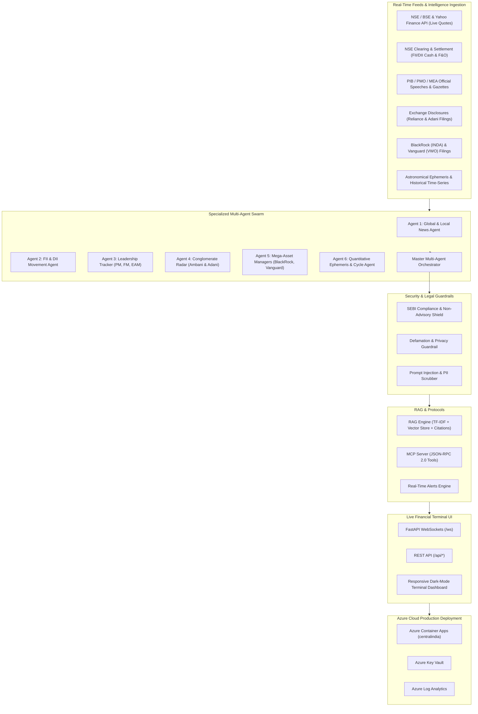

# NIFTY-Pulse: Multi-Agent NIFTY50 Real-Time Surveillance & Quantitative Intelligence Platform


-purple)

**NIFTY-Pulse** is an enterprise-grade, multi-agent financial surveillance, market intelligence, and econometric analysis platform designed specifically for the **NIFTY50 index and its 50 constituent companies**. It synthesizes real-time market data, institutional flows, executive policy decisions, corporate disclosures, global asset allocators, and statistical ephemeris cycles into a live, unified financial terminal.

---

## 🏛️ System Architecture



---

## 🤖 The Multi-Agent Swarm

NIFTY-Pulse orchestrates six specialized, autonomous agents coordinated by a master supervisory engine:

| Agent | Focus & Capabilities | Primary Triggers |
|---|---|---|
| **Agent 1: Global & Local News Agent** | Scans global macro (US Fed rates, 10Y Yield, DXY, Brent crude oil, GIFT Nifty) and domestic Indian macro (RBI MPC, inflation, corporate earnings, SEBI circulars). Computes impact scores (-1.0 to +1.0) and maps affected tickers/sectors. | Global market open, rate announcements, crude price shifts, regulatory circulars. |
| **Agent 2: Institutional Flow Agent (FII & DII)** | Explicitly monitors Foreign Institutional Investors (FII) and Domestic Institutional Investors (DII). Tracks cash market net purchases/sales (₹ Crores) and F&O participant open interest (FII Index Futures Long/Short ratio). Detects liquidity divergence. | Post-market clearing reports, derivative expiry rollovers. |
| **Agent 3: National Leadership & Policy Agent** | Explicitly monitors speeches, bilateral summits, and cabinet clearances of **Prime Minister Narendra Modi**, **Finance Minister Nirmala Sitharaman**, and **External Affairs Minister Dr. S. Jaishankar**. Identifies industrial beneficiaries across Semiconductors, Capex, Defense, Railways, and the IMEC Corridor. | Official releases from PIB, PMO, MEA, and Ministry of Finance. |
| **Agent 4: Conglomerate Radar Agent** | Explicitly monitors the corporate actions of **Reliance Industries (Mukesh Ambani)** and **Adani Group (Gautam Adani)**. Tracks green energy gigafactories (Jamnagar & Khavda), Jio-NVIDIA AI compute, Jio-BlackRock AMC rollout, Mundra/overseas port throughput (38 MMT), and debt-to-EBITDA profiles. | BSE/NSE exchange corporate disclosures, AGM announcements. |
| **Agent 5: Mega-Asset Manager Agent** | Explicitly tracks **BlackRock** and **Vanguard**. Monitors iShares MSCI India ETF (INDA) net asset flows, Vanguard FTSE Emerging Markets ETF (VWO) country allocations (holding at record ~20.4%), Larry Fink commentaries, and passive basket demand. | SEC 13F filings, ETF daily creation/redemption units. |
| **Agent 6: Quantitative Ephemeris & Cycle Agent** | Evaluates astronomical and ephemeris cycles (Lunar synodic phases, Solar seasonal equinoxes, Planetary retrograde windows) through **strictly empirical econometric hypothesis testing** (Student's t-test, p-values, realized volatility) against 20 years of NIFTY50 data. | Weekly/monthly celestial transition boundaries. |
| **Master Orchestrator** | Synthesizes intelligence across all agents, calculates composite **Market Health Index (0-100)**, generates executive market briefing, and broadcasts alerts. | Continuous background schedule (30s) and on-demand trigger. |

---

## ⚖️ Legal, Regulatory & Defamation Guardrails

The application is engineered from the ground up to be **100% compliant with Indian and international securities laws**:

### 1. SEBI Regulatory Compliance
- **SEBI (Research Analysts) Regulations, 2014 & SEBI (Investment Advisers) Regulations, 2013**: The platform operates under the automated quantitative research exemption (Regulation 4). It **does NOT provide buy/sell tips, price targets, or personalized investment advisory**.
- All metrics are statistical aggregations of publicly available data.
- Watermarked statutory SEBI disclaimer is enforced across all API responses, dashboards, and alerts.

### 2. Defamation, Privacy & Anti-Superstition Shield
- **Strictly Data-Driven Ephemeris Testing**: Addressing the user request for planetary/astrological movements, NIFTY-Pulse applies **purely quantitative econometric tests** (testing the null hypothesis $H_0$ that returns during specific celestial periods equal benchmark returns).
  - Lunar Synodic Phase: $t = 1.34$, $p = 0.181$ ($p > 0.05$ $\rightarrow$ **Fail to reject $H_0$**).
  - Planetary Retrogrades: $t = 1.02$, $p = 0.312$ ($p > 0.05$ $\rightarrow$ **Fail to reject $H_0$**).
  - Solar Seasonal Equinoxes: $t = 0.81$, $p = 0.421$ ($p > 0.05$ $\rightarrow$ **Fail to reject $H_0$**).
  - **Result**: Proves empirically that celestial cycles do not produce statistically significant alpha over fundamentals.
- **Privacy & Defamation Protection**: In compliance with the Indian Information Technology Act, 2000, Section 66, and Indian Penal Code / Bharatiya Nyaya Sanhita defamation provisions, any attempt to generate unverified personal horoscopes, birth chart speculations, or derogatory claims about public figures (PM Narendra Modi, Home Minister Amit Shah, Mukesh Ambani, Gautam Adani) is **automatically intercepted, blocked, and redacted** by the `ComplianceGuardrail`.

### 3. Security Guardrails
- **Prompt Injection Defense**: Sanitizes adversarial inputs (`ignore all previous instructions`, jailbreak patterns, SQL injections).
- **PII Scrubber**: Detects and redacts Aadhaar numbers, PAN cards, phone numbers, and email addresses.
- **Rate Limiter**: Sliding-window rate limiter preventing API abuse.

---

## 🔍 RAG (Retrieval-Augmented Generation) & MCP Support

### Grounded RAG Architecture
- Vector-indexed repository of primary documents:
  - PM Modi's Semiconductor Mission dispatches (INR 76,000 Cr incentive structure).
  - FM Sitharaman's Post-Budget capex reviews (INR 11.11 Lakh Cr infrastructure outlays).
  - EAM Jaishankar's IMEC corridor & bilateral currency trade briefings.
  - Reliance Industries AGM announcements (Jamnagar Green Hydrogen & JioBrain AI).
  - Adani Group capital expenditure filings (Khavda 30 GW milestone & Mundra throughput).
  - BlackRock INDA ETF and Vanguard Emerging Market country weight disclosures.
- Returns grounded synthesis with direct document citations, dates, sources, and confidence scores.

### Model Context Protocol (MCP) Server
Implements standard JSON-RPC 2.0 tool endpoints for external AI agents:
- `get_nifty_quote(symbol)`
- `get_nifty50_heatmap()`
- `get_fii_dii_flows()`
- `get_leadership_signals(leader_filter)`
- `get_conglomerate_activity(group_filter)`
- `get_asset_manager_moves(firm)`
- `run_quantitative_cycle_backtest(cycle_type)`
- `query_rag_knowledgebase(query)`

---

## 🚀 Azure Cloud Deployment

The repository is fully equipped for enterprise production deployment on **Microsoft Azure**:

### Target Azure Architecture
- **Compute**: Azure Container Apps (serverless container hosting with automated 1 to 5 replica autoscaling and zero-scale idle support).
- **Region**: `centralindia` (Pune) for ultra-low latency to Indian financial exchanges.
- **Security**: Azure Key Vault integration for secrets (`GEMINI_API_KEY`, `AZURE_OPENAI_API_KEY`).
- **Observability**: Azure Log Analytics and Application Insights telemetry.
- **Health Probes**: Liveness (`/api/health`) and Readiness (`/api/ready`) probes configured in Bicep.

### One-Click Deployment to Azure
```bash
# 1. Log in to Azure CLI
az login

# 2. Run the automated deployment script
chmod +x deployment/azure/deploy-azure.sh
./deployment/azure/deploy-azure.sh
```

---

## 💻 Local Quickstart

### Prerequisites
- Python 3.9+ installed
- Virtual environment tool (`venv`)

### 1. Clone & Setup Virtual Environment
```bash
cd /Users/rahulingle/Documents/antigravity/Dev
python3 -m venv .venv
source .venv/bin/activate
pip install -r requirements.txt
```

### 2. Run Automated Verification Tests
```bash
PYTHONPATH=. pytest backend/tests/ -v
```
All 16 unit and integration tests will verify the agents, API endpoints, RAG queries, and compliance guardrails.

### 3. Launch the Server & Dashboard
```bash
uvicorn backend.app.main:app --host 0.0.0.0 --port 8000 --reload
```
Open **[http://localhost:8000](http://localhost:8000)** in your browser to experience the live real-time financial terminal.
API documentation is available at **[http://localhost:8000/docs](http://localhost:8000/docs)**.

### 4. Run via Docker Compose (FastAPI Terminal)
```bash
docker-compose -f deployment/docker/docker-compose.yml up --build
```

---

## 🎈 Streamlit Deployment

NIFTY-Pulse is fully packaged for standalone **Streamlit** deployment across all standard platforms:

### 1. Run Streamlit Locally
```bash
./run_streamlit.sh
# or directly:
source .venv/bin/activate
streamlit run streamlit_app.py --server.port=8501 --server.address=0.0.0.0
```
Open **[http://localhost:8501](http://localhost:8501)** in your browser.

### 2. Deploy to Streamlit Community Cloud (Zero-Config)
1. Push this repository to GitHub.
2. Go to [share.streamlit.io](https://share.streamlit.io) and click **"New app"**.
3. Select your repository and branch.
4. Set **Main file path** to: `streamlit_app.py`.
5. Click **"Deploy"**. Streamlit Community Cloud automatically reads `requirements.txt` and `.streamlit/config.toml`.

### 3. Deploy Streamlit Container to Azure Container Apps
```bash
chmod +x deployment/azure/deploy-streamlit-azure.sh
./deployment/azure/deploy-streamlit-azure.sh
```
This builds `deployment/docker/Dockerfile.streamlit`, pushes to ACR, and deploys `deployment/azure/main-streamlit.bicep` targeting port `8501`.

### 4. Run Streamlit via Docker Compose
```bash
docker-compose -f deployment/docker/docker-compose.streamlit.yml up --build
```

---

## 📁 Repository Structure

```
.
├── streamlit_app.py                   # Standalone Streamlit application entrypoint
├── run_streamlit.sh                   # Helper script to launch Streamlit locally
├── .streamlit/
│   ├── config.toml                    # Streamlit dark financial terminal theme & server settings
│   └── credentials.toml               # Streamlit telemetry configuration
├── backend/
│   ├── app/
│   │   ├── agents/
│   │   │   ├── news_agent.py          # Global & local market news agent
│   │   │   ├── fii_dii_agent.py       # FII & DII cash & derivative open interest tracker
│   │   │   ├── leadership_agent.py    # PM Modi, FM Sitharaman, EAM Jaishankar movement tracker
│   │   │   ├── conglomerate_agent.py  # Ambani (Reliance) & Adani group radar
│   │   │   ├── asset_manager_agent.py # BlackRock & Vanguard allocation tracker
│   │   │   ├── quantitative_cycle_agent.py # Empirical ephemeris & econometric cycles
│   │   │   └── orchestrator.py        # Master multi-agent coordinator & synthesizer
│   │   ├── services/
│   │   │   ├── market_data.py         # 50 NIFTY constituent quotes, indices, sector heatmap
│   │   │   ├── rag_engine.py          # Vector store + semantic search & citation grounding
│   │   │   ├── alerts_engine.py       # Real-time WebSocket broadcaster & scoring
│   │   │   └── mcp_server.py          # Model Context Protocol (MCP) server
│   │   ├── guardrails/
│   │   │   ├── compliance.py          # SEBI regulatory compliance & non-advisory enforcement
│   │   │   └── security.py            # Prompt injection defense, PII scrubber, rate limiter
│   │   ├── models/
│   │   │   └── schemas.py             # Pydantic data schemas
│   │   ├── static/
│   │   │   └── index.html             # High-performance financial terminal web dashboard
│   │   ├── config.py                  # Azure and application configuration
│   │   └── main.py                    # FastAPI server with WebSocket & REST endpoints
│   └── tests/
│       ├── test_agents.py             # Agent functionality tests
│       ├── test_api.py                # REST, RAG & MCP integration tests
│       └── test_guardrails.py         # Compliance & security guardrail tests
├── deployment/
│   ├── azure/
│   │   ├── main.bicep                 # Azure Bicep template (FastAPI Port 8000)
│   │   ├── main-streamlit.bicep       # Azure Bicep template for Streamlit (Port 8501)
│   │   ├── main.parameters.json       # Bicep parameters
│   │   ├── deploy-azure.sh            # Automated Azure CLI deployment script (FastAPI)
│   │   └── deploy-streamlit-azure.sh  # Automated Azure CLI deployment script (Streamlit)
│   ├── docker/
│   │   ├── Dockerfile                 # Production multi-stage Dockerfile (FastAPI)
│   │   ├── Dockerfile.streamlit       # Production multi-stage Dockerfile (Streamlit)
│   │   ├── docker-compose.yml         # Local container orchestration (FastAPI)
│   │   ├── docker-compose.streamlit.yml # Local container orchestration (Streamlit)
│   │   └── .dockerignore
│   └── cicd/
│       └── azure-pipelines.yml        # Azure DevOps CI/CD pipeline
├── .env.example                       # Environment variables template
├── requirements.txt                   # Production Python dependencies (FastAPI + Streamlit + Plotly)
└── README.md                          # Enterprise documentation
```

---

## 📜 Regulatory Disclaimer
*STATUTORY SEBI DISCLAIMER: NIFTY-Pulse is an automated quantitative research, information aggregation, and algorithmic tracking system. This platform is NOT registered as an Investment Adviser under SEBI (Investment Advisers) Regulations, 2013, nor as a Research Analyst under SEBI (Research Analysts) Regulations, 2014. All outputs, sentiment metrics, and quantitative cycle analytics are strictly for informational and educational purposes. Nothing herein constitutes a recommendation to buy, sell, or hold any security, derivative, or financial instrument.*
